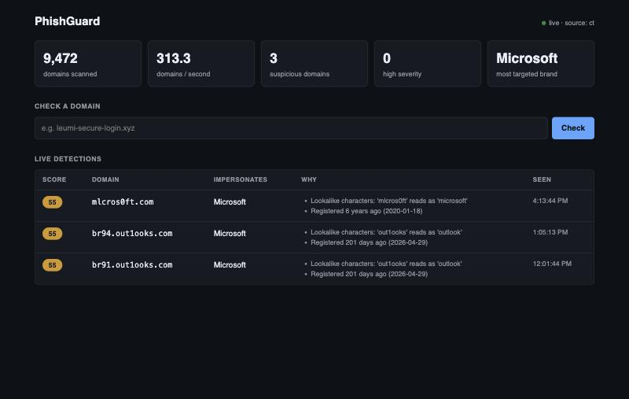
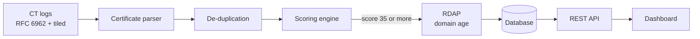

<h1 align="center">PhishGuard</h1>

<p align="center">
  Real-time detection of domains that impersonate well-known brands,<br>
  built on public Certificate Transparency logs.
</p>

<p align="center">
  <a href="https://github.com/ofekfanian/phishguard/actions/workflows/tests.yml"></a>
  
  
  
</p>

<p align="center">
  
</p>

## Overview

Every publicly trusted HTTPS certificate is recorded in public
[Certificate Transparency](https://certificate.transparency.dev/) (CT) logs, usually
minutes before the site behind it goes live. PhishGuard follows those logs, scores
each newly certified domain for brand impersonation, and serves the results through
a REST API and a live dashboard.

For example, `leumi.co.il.verify-account.top` scores 100/100: it embeds a bank's real
domain as a subdomain of an unrelated one, uses phishing keywords, and sits on a TLD
that is common in phishing campaigns.

## Highlights

- **Direct CT log reader.** Follows 14 public logs with no third-party feed, account
  or API key. Supports both log generations: the RFC 6962 JSON API and the newer
  tiled logs (static-ct-api) used by Let's Encrypt.
- **Explainable scoring.** Every detection carries a 0-100 score and a written
  reason for each point, so an analyst can see why a domain was flagged.
- **Lookalike detection.** Catches digit swaps (`paypa1`), `l`/`i` swaps
  (`mlcros0ft`), Cyrillic and Greek homoglyphs in punycode, and typosquatting.
- **Domain age enrichment.** Looks up each candidate's registration date over RDAP
  and adjusts the score.
- **Passive by design.** Reads public logs and registry records only. It never
  connects to a flagged site.
- **Tested.** 51 automated tests, run on every pull request with GitHub Actions.

## Results on live data

In its first hours on live CT logs (about 140,000 domains in the first 42 minutes
alone), PhishGuard flagged two lookalike domains:

| Domain | Reads as | Registered |
| --- | --- | --- |
| `out1ooks.com` | outlook | April 2026 |
| `mlcros0ft.com` | microsoft | January 2020 |

Whether these domains are used for phishing was not verified, because PhishGuard
never visits a flagged site.

The same run exposed three scoring problems, such as `microsport.gr` being flagged
as a typo of "microsoft". Each one was fixed and is covered by a regression test.

## Architecture



| Module | Role |
| --- | --- |
| [`phishguard/ct.py`](phishguard/ct.py) | Follows public CT logs and parses each new certificate |
| [`phishguard/scorer.py`](phishguard/scorer.py) | The detection engine: score and reasons for a domain |
| [`phishguard/enrich.py`](phishguard/enrich.py) | Looks up registration dates over RDAP |
| [`phishguard/pipeline.py`](phishguard/pipeline.py) | De-duplicates, scores, and saves one detection per registered domain |
| [`phishguard/store.py`](phishguard/store.py) | Database layer |
| [`phishguard/api.py`](phishguard/api.py) | REST API and dashboard |
| [`phishguard/sources.py`](phishguard/sources.py) | Simulated demo feed and a CertStream client |
| [`phishguard/config.py`](phishguard/config.py) | Protected brands and settings |

## Built with

| Area | Technology | Used for |
| --- | --- | --- |
| Language | Python 3.12, asyncio | One async task per CT log |
| Web | [FastAPI](https://fastapi.tiangolo.com/), Uvicorn | REST API with generated OpenAPI docs |
| HTTP | [httpx](https://www.python-httpx.org/) | Async calls to CT logs and RDAP servers |
| Certificates | [cryptography](https://cryptography.io/) | Parsing X.509 certificates and pre-certificates |
| Domains | [tldextract](https://github.com/john-kurkowski/tldextract) | Splitting hostnames with the Public Suffix List |
| Matching | [RapidFuzz](https://github.com/rapidfuzz/RapidFuzz) | Edit distance for typosquatting |
| Storage | [SQLAlchemy](https://www.sqlalchemy.org/) 2, SQLite | Detections (any SQLAlchemy database URL works) |
| Frontend | HTML, CSS, JavaScript (no framework) | Live dashboard |
| Testing | pytest, GitHub Actions | 51 tests on every pull request |

Protocols and data sources: Certificate Transparency
([RFC 6962](https://datatracker.ietf.org/doc/html/rfc6962) and
[static-ct-api](https://c2sp.org/static-ct-api)), RDAP
([RFC 9082](https://datatracker.ietf.org/doc/html/rfc9082)), the IANA RDAP bootstrap
registry, and Google's public CT log list.

## How scoring works

| Signal | Example | Points |
| --- | --- | --- |
| Lookalike characters (digits, `l` for `i`, Cyrillic/Greek letters, `rn` for `m`) | `paypa1.com`, `mlcros0ft.com` | 55 |
| Typosquatting (edit distance) | `paypol.com` | 45 |
| Brand name in a domain the brand does not own | `leumi-login.com` | 40 |
| Brand name hidden inside a longer word | `myleumionline.com` | 35 |
| Real domain embedded as a subdomain | `leumi.co.il.evil.top` | +20 |
| Phishing keywords (`login`, `verify`, `secure`...) | | +15 to +25 |
| TLD common in phishing | `.xyz`, `.top` | +15 |
| Punycode | `xn--pypal-4ve.com` | +10 |
| Registered in the last 30 days | | +15 |
| Registered more than 1 / 2 years ago | | -10 / -20 |

A domain is saved as a detection at 50 points or more. A brand name alone (40) or a
typo alone (45) is deliberately below that, which keeps `mizrahi-family.com` and
`microsport.gr` out of the results.

**Domain age.** Phishing domains are usually days old. For every domain that scores
35 or more, PhishGuard asks the domain registry when it was registered. Age never
lowers the score of a lookalike domain, because swapped characters are deliberate at
any age. The lookup is skipped for TLDs with no RDAP server, such as `.il` and `.de`.

## Getting started

```bash
python3 -m venv .venv
.venv/bin/pip install -r requirements.txt
.venv/bin/python -m phishguard
```

Open http://localhost:8000 for the dashboard and http://localhost:8000/docs for the
interactive API documentation. By default PhishGuard runs on a simulated feed.

Run on live data:

```bash
PHISHGUARD_SOURCE=ct .venv/bin/python -m phishguard
```

Run the tests:

```bash
.venv/bin/python -m pytest
```

In live mode PhishGuard downloads the public list of CT logs, picks the ones in use
today, and follows each of them. Some logs rate-limit clients (HTTP 429); PhishGuard
backs off and retries on its own.

## Configuration

| Variable | Default | Meaning |
| --- | --- | --- |
| `PHISHGUARD_SOURCE` | `demo` | `demo`, `ct`, `certstream` or `none` |
| `PHISHGUARD_DB` | `sqlite:///phishguard.db` | Any SQLAlchemy database URL |
| `PHISHGUARD_THRESHOLD` | `50` | Minimum score to save a detection |
| `PHISHGUARD_ENRICH` | `1` in live mode, `0` in demo | Look up domain age over RDAP |
| `PHISHGUARD_CT_LOGS` | discovered automatically | Comma-separated RFC 6962 log URLs |
| `PHISHGUARD_CT_TILED_LOGS` | discovered automatically | Comma-separated tiled log URLs |
| `PHISHGUARD_CERTSTREAM_URL` | `ws://localhost:8080/domains-only` | CertStream WebSocket URL |

The CertStream mode (`PHISHGUARD_SOURCE=certstream`) has not been tested against a
real server.

## API

| Endpoint | Description |
| --- | --- |
| `GET /api/detections?min_score=&brand=&limit=` | Latest suspicious domains |
| `GET /api/check?domain=` | Score any domain on demand |
| `GET /api/stats` | Throughput and detection counts |
| `GET /api/brands` | Protected brands |

```bash
curl "http://localhost:8000/api/check?domain=paypa1-verify.com"
```

```json
{
  "domain": "paypa1-verify.com",
  "registered_domain": "paypa1-verify.com",
  "score": 70,
  "severity": "medium",
  "brand": "PayPal",
  "reasons": [
    "Lookalike characters: 'paypa1' reads as 'paypal'",
    "Phishing keywords: verify"
  ]
}
```

## Security notes

- Domain names are attacker-controlled input. The dashboard inserts them as text
  only, never as HTML and never as clickable links.
- PhishGuard is passive: it reads public logs and registry records, and never
  connects to a suspicious site.

## Limitations and roadmap

- The protected brand list is small (seven brands) and lives in code.
- Detections are not verified against the live site or a threat-intelligence feed.
- It runs as a single process with SQLite, and has not been deployed to a server.

Planned next:

- [ ] Enrichment with DNS records and hosting provider
- [ ] Cross-checking detections with URLhaus and Google Safe Browsing
- [ ] Alerts for high-severity detections
- [ ] PostgreSQL and Docker Compose
- [ ] Deployment to a public URL
